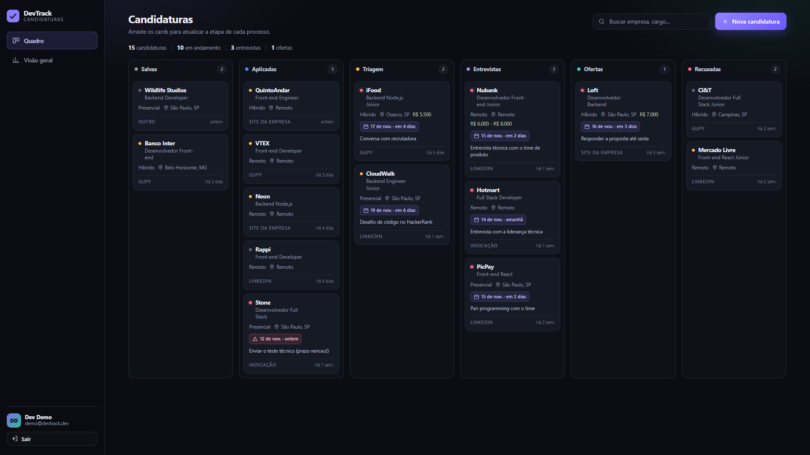
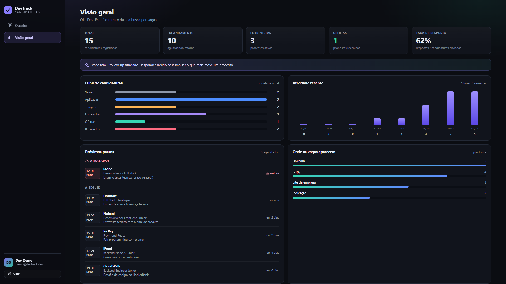
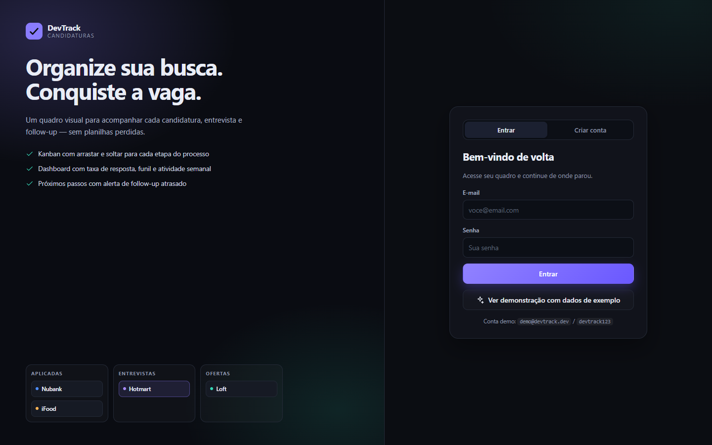
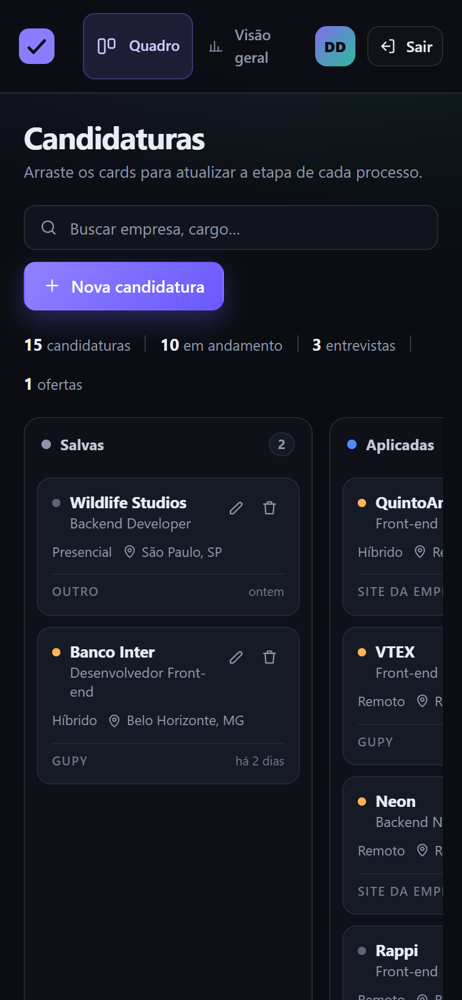

# DevTrack

**Organize sua busca por vagas. Conquiste a entrevista.**

Aplicação **full stack** para acompanhar candidaturas de emprego em um kanban, com dashboard de funil, taxa de resposta e alertas de follow-up.
*Full stack job application tracker built with React, Node.js and TypeScript.*

[](https://github.com/SEU-USUARIO/devtrack/actions/workflows/ci.yml)


> Projeto de portfólio: nasceu de um problema real — perder prazos e não saber em qual etapa cada candidatura estava. Hoje é uma aplicação completa, com autenticação, API REST, testes automatizados, CI e deploy.

---

## Sumário

- [Screenshots](#screenshots)
- [Funcionalidades](#funcionalidades)
- [Stack](#stack)
- [Arquitetura](#arquitetura)
- [Rodando localmente](#rodando-localmente)
- [Testes](#testes)
- [API](#api)
- [Decisões técnicas](#decisões-técnicas)
- [Estrutura do projeto](#estrutura-do-projeto)
- [Deploy](#deploy)
- [Roadmap](#roadmap)

---

## Screenshots

<p align="center">
  
</p>

<p align="center">
  
</p>

<p align="center">
  
  
</p>

---

## Funcionalidades

- **Kanban com drag & drop nativo** — seis etapas: salva, aplicada, triagem, entrevista, oferta e recusada.
- **CRUD completo de candidaturas** — empresa, cargo, modelo de trabalho (remoto/híbrido/presencial), fonte, faixa salarial, link, anotações e prioridade.
- **Próximo passo com data** — destaque visual para follow-ups atrasados.
- **Dashboard** — total, processos em andamento, entrevistas, ofertas, taxa de resposta, funil por etapa, atividade das últimas 8 semanas e origem das vagas.
- **Busca instantânea** por empresa, cargo, local ou anotação.
- **Autenticação** — cadastro/login com senha protegida por `scrypt` e sessão via JWT.
- **Multi-usuário** — cada pessoa só enxerga as próprias candidaturas.
- **Responsivo** — layout adaptado para desktop, tablet e celular.
- **Dados de demonstração** criados automaticamente em banco vazio.

## Stack

| Camada | Tecnologias |
| --- | --- |
| Front-end | React 19, TypeScript, Vite 7, CSS puro (design system com variáveis) |
| Back-end | Node.js 22+, Express 5, TypeScript, Zod 4 |
| Banco | SQLite nativo (`node:sqlite`) — sem ORM e sem dependência externa |
| Autenticação | JWT (7 dias), hash de senha com `scrypt` + salt aleatório |
| Testes | `node:test` + `fetch` (sem Jest/Supertest) |
| Infra | npm workspaces, GitHub Actions, Render |

## Arquitetura

```text
┌──────────────────────────────┐            HTTP/JSON            ┌─────────────────────────────┐
│  React 19 + Vite  (:5173)    │  ───────────────────────────▶  │  Express 5      (:4000)     │
│  kanban · dashboard · auth   │  ◀───────────────────────────  │  Zod · JWT · scrypt         │
└──────────────────────────────┘                                └──────────────┬──────────────┘
                                                                               │ SQL
                                                                  ┌────────────▼─────────────┐
                                                                  │  SQLite (node:sqlite)    │
                                                                  │  users · applications    │
                                                                  └──────────────────────────┘
```

Em desenvolvimento o Vite faz proxy de `/api` para o Express. Em produção, **um único serviço** roda a API e serve o build estático do front-end (`server/src/app.ts`), o que simplifica o deploy.

### Modelo de dados

```text
users                      applications
─────                      ────────────
id (PK)                    id (PK)
name                       user_id (FK → users.id, ON DELETE CASCADE)
email (UNIQUE)             company / role / location
password_hash              work_mode · source · status · priority
created_at                 salary · url · notes
                           applied_at · next_step_at · next_step_note
                           created_at · updated_at
```

## Rodando localmente

### Pré-requisitos

- **Node.js 22.13+** (recomendado 24 ou 26) e npm.
- Nenhum banco para instalar: o SQLite é criado em `server/data/devtrack.db`.

### Passo a passo

```bash
# 1. instale as dependências dos dois workspaces
npm install

# 2. (opcional) crie a conta demo com 15 candidaturas de exemplo
npm run seed

# 3. suba API + front em modo desenvolvimento
npm run dev
```

- Front-end: <http://localhost:5173>
- API: <http://localhost:4000/api/health>

**Conta demo:** `demo@devtrack.dev` / `devtrack123`

Também é possível entrar direto pelo botão **“Ver demonstração com dados de exemplo”** na tela de login.

### Scripts

| Comando | O que faz |
| --- | --- |
| `npm run dev` | API + front com hot reload |
| `npm run dev:server` / `npm run dev:web` | Sobe só um dos lados |
| `npm run build` | Compila TypeScript do servidor e gera o build do Vite |
| `npm start` | Produção: API + front no mesmo serviço (`:4000`) |
| `npm test` | Roda a suíte da API |
| `npm run seed` | Recria a conta e os dados demo |

### Variáveis de ambiente

Crie `server/.env` a partir de `server/.env.example` (opcional em desenvolvimento):

| Variável | Padrão | Descrição |
| --- | --- | --- |
| `PORT` | `4000` | Porta da API |
| `JWT_SECRET` | segredo de dev | **Obrigatório em produção** |
| `DB_PATH` | `server/data/devtrack.db` | Caminho do arquivo SQLite |
| `WEB_ORIGIN` | `http://localhost:5173` | Origem liberada no CORS em dev |
| `SEED_DEMO` | `true` | Cria a conta demo se o banco estiver vazio |

## Testes

```bash
npm test
```

14 testes de integração cobrindo:

- health check e cadastro (incluindo e-mail duplicado e validação);
- login com credenciais válidas e inválidas;
- bloqueio de rotas protegidas sem token;
- criação, listagem, busca, atualização e remoção de candidaturas;
- **isolamento entre usuários** (um usuário não acessa dados de outro);
- cálculo das estatísticas do dashboard.

Os testes sobem o app em uma porta aleatória, usam um banco SQLite temporário e são executados no CI a cada push/PR.

## API

Base: `http://localhost:4000/api`

| Método | Rota | Descrição | Auth |
| --- | --- | --- | --- |
| `GET` | `/health` | Status do serviço | — |
| `POST` | `/auth/register` | Cria conta e retorna token | — |
| `POST` | `/auth/login` | Autentica e retorna token | — |
| `GET` | `/auth/me` | Usuário autenticado | Bearer |
| `GET` | `/applications?status=&q=&sort=` | Lista com filtro e ordenação | Bearer |
| `POST` | `/applications` | Cria candidatura | Bearer |
| `GET` | `/applications/:id` | Detalhe | Bearer |
| `PATCH` | `/applications/:id` | Atualiza campos (inclusive `status`) | Bearer |
| `DELETE` | `/applications/:id` | Remove | Bearer |
| `GET` | `/stats` | Métricas do dashboard | Bearer |

Exemplo:

```bash
curl -X POST http://localhost:4000/api/auth/login \
  -H "Content-Type: application/json" \
  -d '{"email":"demo@devtrack.dev","password":"devtrack123"}'

curl http://localhost:4000/api/applications \
  -H "Authorization: Bearer SEU_TOKEN"
```

Erros seguem o formato `{ "error": "mensagem", "details": [...] }` com `400`, `401`, `404`, `409` ou `500`.

## Decisões técnicas

Pontos que costumo explicar em entrevista:

1. **`node:sqlite` em vez de ORM.** Zero dependências de banco, SQL explícito e `DatabaseSync` nativo. O trade-off é acoplamento ao SQLite — o próximo passo para escalar é trocar por Postgres com Drizzle/Prisma, mantendo as queries isoladas em `server/src/db.ts`.
2. **`scrypt` do `node:crypto` em vez de bcrypt.** Evita dependência com build nativo e usa um KDF recomendado, com salt por usuário e comparação em tempo constante (`timingSafeEqual`).
3. **JWT no `localStorage`.** Simples para uma demo e para explicar o fluxo completo. Em produção, a escolha mais segura seria cookie `httpOnly` + `SameSite` + proteção CSRF.
4. **Drag & drop com a API nativa do HTML5.** Nenhuma biblioteca extra no bundle e domínio real dos eventos `dragstart/dragover/drop`. Com atualização otimista e rollback em caso de erro de rede. Para acessibilidade completa, o próximo passo é `dnd-kit` com suporte a teclado.
5. **CSS puro com design tokens.** Sem Tailwind/build extra: um arquivo com variáveis demonstra domínio de layout (grid/flex), responsividade e estados.
6. **Testes com `node:test` + `fetch`.** Sem Jest/Supertest: a suíte roda rápido e testa a API pela mesma interface que o front usa.
7. **Zod na borda da aplicação.** Toda entrada é validada antes de tocar no banco, e as mensagens de erro alimentam o formulário do front.

## Estrutura do projeto

```text
devtrack/
├─ server/                     # API
│  ├─ src/
│  │  ├─ app.ts                # Express, CORS, static, error handler
│  │  ├─ auth.ts               # scrypt, JWT, middleware
│  │  ├─ db.ts                 # schema + repositório SQL
│  │  ├─ demo.ts               # dados de exemplo / auto-seed
│  │  ├─ schemas.ts            # validação com Zod
│  │  ├─ routes/               # auth, applications, stats
│  │  └─ types.ts              # contratos e mapeamento do banco
│  └─ test/api.test.ts         # testes de integração
├─ web/                        # React + Vite
│  └─ src/
│     ├─ api.ts                # cliente HTTP + token
│     ├─ pages/                # BoardPage, DashboardPage
│     ├─ components/           # AuthPage, ApplicationModal, Icons
│     └─ styles.css            # design system
├─ docs/                       # screenshots e guias de publicação
├─ .github/workflows/ci.yml    # build + testes
└─ render.yaml                 # deploy no Render
```

## Deploy

### Render (API + front no mesmo serviço)

1. Suba o repositório no GitHub.
2. No Render: **New → Blueprint**, aponte para o repositório e confirme o `render.yaml`.
3. O blueprint já configura build, start, health check, `JWT_SECRET` e um disco de 1 GB para o SQLite.
4. O disco persistente exige plano **Starter** (pago). No plano free, remova o bloco `disk`: a aplicação funciona, mas o banco é recriado com os dados demo a cada deploy/restart (bom o suficiente para uma demo pública).

### Alternativas

- **Vercel/Netlify** para o front + Render/Fly.io para a API (lembre de configurar `VITE_API_URL` e `WEB_ORIGIN`).
- **Docker** (roadmap): um `Dockerfile` multi-stage com o mesmo comando de start.

> Em produção, troque o SQLite por Postgres antes de usar com dados reais de muitas pessoas. O SQL está concentrado em um único arquivo para facilitar essa migração.

## Roadmap

- [ ] Migrar a persistência para Postgres + Drizzle ORM.
- [ ] Sessão com cookie `httpOnly` e refresh token.
- [ ] Rate limiting e verificação de e-mail.
- [ ] Lembretes de follow-up por e-mail.
- [ ] Importar vaga a partir de uma URL (título/empresa).
- [ ] Testes E2E com Playwright e testes de acessibilidade.
- [ ] Docker + deploy alternativo.
- [ ] i18n (PT/EN) e tema claro.

## Autor

**Seu Nome** — *edite esta seção antes de publicar*

- LinkedIn: [linkedin.com/in/seu-usuario](https://www.linkedin.com/in/seu-usuario/)
- GitHub: [github.com/SEU-USUARIO](https://github.com/SEU-USUARIO)
- E-mail: seu@email.com

Se este projeto te ajudou de alguma forma, deixe uma ⭐ — e me chame para conversar sobre vagas, código ou café. ☕

## Licença

MIT — veja [LICENSE](LICENSE).
